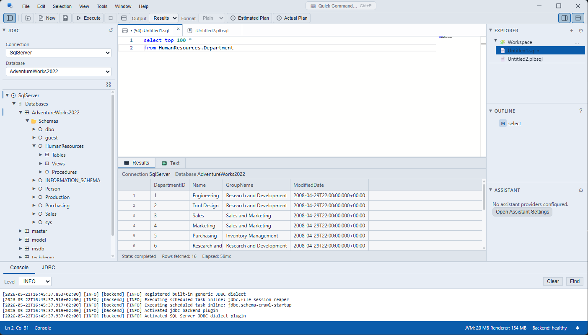

[](https://github.com/kuseman/payloadbuilder/actions)

# Payloadbuilder

SQL query engine with plugable catalogs (data sources)

## Table of Contents

* [About the Project](#about-the-project)
  * [Catalogs](#catalogs)
  * [Built With](#built-with)
* [Usage](#usage)
* [Getting Started](#getting-started)
  * [Queryeer IDE](#queryeer-ide)
* [Roadmap](#roadmap)
* [Contributing](#contributing)
* [License](#license)

## About the project

Query engine with SQL support, easy to extend with catalogs to allow for joining data sets from completely different data sources.
A simple analyzer that builds an operator tree from provided query for data retrieval.

Supports:

* JOIN (INNER, LEFT)
* APPLY (CROSS, OUTER)
* TVF's
* Scalar functions
* Key lookup Index
* Multiple statements
* Control-flow statements

[Grammar](https://github.com/kuseman/payloadbuilder/blob/master/payloadbuilder-core/src/main/resources/antlr4/se/kuseman/payloadbuilder/core/parser/PayloadBuilderQuery.g4)

### Catalogs

Catalogs is the extension point where external data is provided.
A catalog implementation can provide scalar functions, table valued functions,
data operators for tables.

[Provided catalogs](https://github.com/kuseman/payloadbuilder/tree/master/payloadbuilder-catalog)

### Built With

* JDK 17
* Maven

## Usage

Maven
```xml
  <dependency>
    <groupId>se.kuseman.payloadbuilder</groupId>
    <artifactId>payloadbuilder-core</artifactId>
    <version>${payloadbuilder.version}</version>
  </dependency>
  <!-- Optionally add bundled catalogs, one artifact per catalog -->
  <dependency>
    <groupId>se.kuseman.payloadbuilder</groupId>
    <artifactId>payloadbuilder-catalog-es</artifactId>
    <version>${payloadbuilder.version}</version>
  </dependency>
  <dependency>
    <groupId>se.kuseman.payloadbuilder</groupId>
    <artifactId>payloadbuilder-catalog-fs</artifactId>
    <version>${payloadbuilder.version}</version>
  </dependency>
```

Bundled catalog artifacts (all with groupId `se.kuseman.payloadbuilder`):

| Catalog | Artifact |
|---|---|
| `ESCatalog` | `payloadbuilder-catalog-es` |
| `FilesystemCatalog` | `payloadbuilder-catalog-fs` |
| `HttpCatalog` | `payloadbuilder-catalog-http` |
| `JdbcCatalog` | `payloadbuilder-catalog-jdbc` |
| `KafkaCatalog` | `payloadbuilder-catalog-kafka` |
| `MongoCatalog` | `payloadbuilder-catalog-mongodb` |

Before 1.15.0 all catalogs were published together as `payloadbuilder-catalog`. That artifact is no longer published,
see the [1.15.0 release notes](documentation/release-notes/1.15.0.md).

## Getting Started

Simple query using multiple catalogs:

```java
        QuerySession session = new QuerySession(new CatalogRegistry());
        session.setPrintWriter(new OutputStreamWriter(System.out));
        session.getCatalogRegistry()
                .registerCatalog("es", new ESCatalog());
        session.getCatalogRegistry()
                .registerCatalog("fs", new FilesystemCatalog());

        session.setCatalogProperty("es", "endpoint", "http://localhost:19200");
        session.setCatalogProperty("es", "index", "myIndex");

        String query = "select top 10 " + "        d.fileName "
                       + ",       f.size "
                       + ",       f.lastModifiedTime "
                       + "from es#_doc d "
                       + "outer apply fs#file(concat('/path/to/files/', d.fileName)) f "
                       + "where d._docType = 'pdfFiles'";

        CompiledQuery compiledQuery = Payloadbuilder.compile(session, query);
        QueryResult queryResult = compiledQuery.execute(session);
        JsonOutputWriter writer = new JsonOutputWriter(new PrintWriter(System.out));
        while (queryResult.hasMoreResults())
        {
            queryResult.writeResult(writer);
        }
```

### Queryeer Desktop IDE

Payloadbuilder is bundled inside Queryeer Desktop IDE

[Queryeer Desktop](https://github.com/kuseman/queryeer-desktop)


## Roadmap

Alot :)
* Documentation
* Insert/Update/Delete support
* More operators (Merge join, union, except, anti-join, semi-join etc.)
* More catalog implementations (Mongo, Redis etc.)

## Contributing

Patches, discussions about features, changes etc. welcome. 

## License

Distributed under the Apache License Version 2.0. See `LICENSE` for more information.
